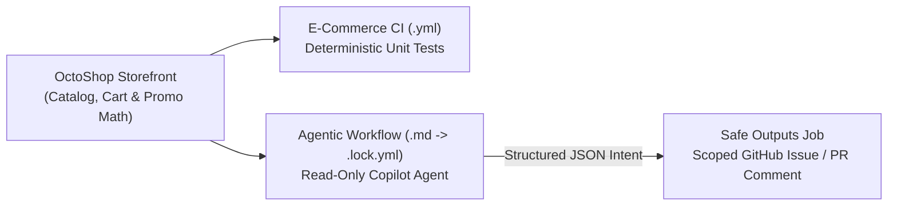

# OctoShop — Getting Started with GitHub Agentic Workflows (`gh-aw`)

A zero-dependency **e-commerce storefront** (`OctoShop`) built so anyone can immediately understand the domain—products, cart totals, promo codes (`SAVE20`, `FREESHIP`), inventory stock, and checkout—while seeing **GitHub Agentic Workflows** in action next to standard GitHub Actions CI.

---

## How It Fits Together



## Session Flow

| Step | Module | What's Inside |
|---|---|---|
| **1. Demo** | **[Daily Repo Status Report](demo/README.md)** | Live walkthrough of [`.github/workflows/daily-repo-status.md`](.github/workflows/daily-repo-status.md) — summarises **open storefront issues, PRs, recent merges, and flash-sale checkout blockers** into a GitHub Issue alongside [`.github/workflows/ci.yml`](.github/workflows/ci.yml) (`E-Commerce CI`). |
| **2. Lab 2** | **[Lab 2: Experiment Against Your Workflow](lab-2/README.md)** | **Path 1**: Pair one starter Agentic Workflow (`ci-failure-explainer.md`, `checkout-pr-review.md`, or `storefront-issue-triage.md`) against `E-Commerce CI` (or your own repo's workflow).<br>**Path 2**: Build a multi-step Copilot Automation (`checkout-auto-handoff.md`) that hands off self-contained checkout bugs to `@copilot`. |

---

## Quick Start

### Try the OctoShop Storefront & Tests Locally (Zero `npm install` Needed!)

```bash
# Run cart, promo-code & stock unit tests + validate all Agentic Workflow (.md) files
npm run verify

# Optional: Launch the OctoShop storefront at http://localhost:3000
npm start
```

### Compile & Run the Getting-Started Agentic Workflow (`gh-aw`)

> **Tip**: Open this repo in **GitHub Codespaces** (`.devcontainer` pre-installs `gh` + `gh-aw`), or run locally on Linux, macOS, or Windows WSL.

```bash
# 1. Install the GitHub Agentic Workflows CLI extension
gh extension install github/gh-aw
gh aw version

# 2. Configure Copilot authentication (Fine-grained PAT with Account -> Copilot Requests: Read)
gh secret set COPILOT_GITHUB_TOKEN < token.txt

# 3. Trigger the pre-compiled Daily Repo Status workflow right away!
gh aw run daily-repo-status
gh run watch

# 4. Whenever you edit daily-repo-status.md, re-compile and push both .md and .lock.yml:
gh aw compile daily-repo-status
git add .gitattributes .github/aw/actions-lock.json .github/workflows/daily-repo-status.*
git commit -m "Update OctoShop daily-repo-status workflow"
git push
```

---

## Repository Layout

```text
.
├── .devcontainer/
│   └── devcontainer.json                           # Codespaces setup with gh + gh-aw pre-installed
├── .gitattributes                                  # Marks *.lock.yml as linguist-generated=true
├── .github/
│   ├── copilot-instructions.md                     # Repo context & gh-aw guardrails
│   └── workflows/
│       ├── ci.yml                                  # Existing "E-Commerce CI" workflow (with simulate_checkout_bug input)
│       └── daily-repo-status.md                    # Getting-started Demo Agentic Workflow
├── demo/
│   ├── README.md                                   # Live presenter walkthrough
│   └── sample-daily-status-issue.md                # Sample generated OctoShop Daily Report issue
├── lab-2/
│   ├── README.md                                   # Hands-on Lab 2 instructions
│   ├── starter-workflows/                          # Path 1: Pair one Agentic Workflow against CI / PRs / Issues
│   │   ├── ci-failure-explainer.md                 # Watches E-Commerce CI & explains checkout failures
│   │   ├── checkout-pr-review.md                   # Audits PRs for pricing, promo & inventory bugs
│   │   └── storefront-issue-triage.md              # Triages customer issues (checkout / cart / catalog)
│   └── advanced-automation/                        # Path 2: Multi-step @copilot automation
│       ├── checkout-responder.agent.md             # Custom Copilot agent (.github/agents/)
│       └── checkout-auto-handoff.md                # Checkout CI failure -> issue -> guarded @copilot fix PR
├── public/                                         # OctoShop storefront UI (HTML/CSS/JS)
├── scripts/
│   ├── seed-demo-repo.ps1                          # E-commerce label & issue seeder (PowerShell)
│   ├── seed-demo-repo.sh                           # E-commerce label & issue seeder (Bash)
│   └── validate-workflows.mjs                      # Zero-dependency gh-aw guardrail validator
├── src/
│   ├── catalog.mjs                                 # Products & promo codes (SAVE20, WELCOME10, FREESHIP)
│   ├── checkout.mjs                                # Cart totals, discounts, shipping & stock checks
│   └── server.mjs                                  # Zero-dependency Node HTTP server (npm start)
└── test/
    └── checkout.test.mjs                           # Built-in node:test checkout test suite
```
